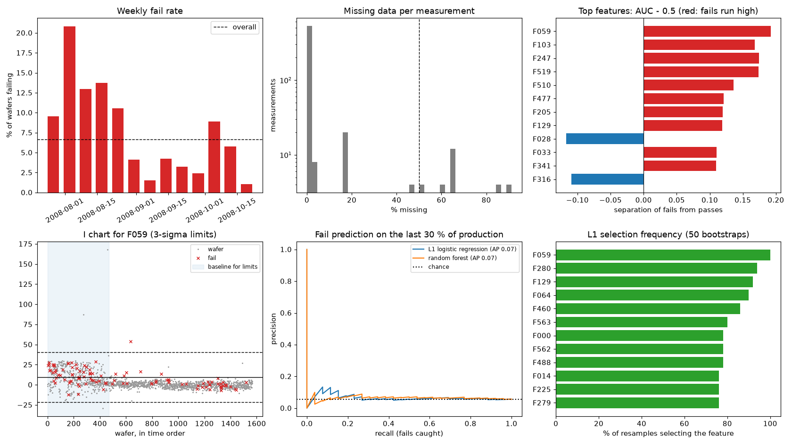
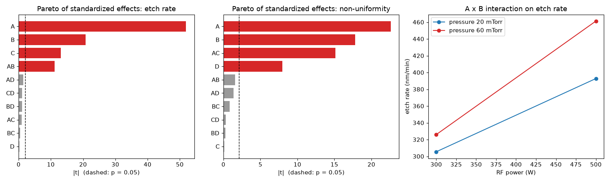

# Semiconductor Yield Root Cause: SPC, Screening and DOE

[](https://github.com/vansh0906/secom-yield-root-cause/actions/workflows/ci.yml)

Root-cause analysis on the **UCI SECOM dataset**: 1,567 wafers from a real semiconductor production line, 590 anonymised sensor and process measurements per wafer, and a pass/fail result from in-line testing. The question a yield engineer asks is *which measurements separate failing wafers from passing ones, and could we have seen it coming?* A second part, `doe.py`, plans and analyses a **designed experiment** on a simulated etch step, the usual way to confirm a suspected cause.



## Method

| Step | What it does | Why |
|---|---|---|
| Data quality | Drops measurements over 50 % missing or never changing; median imputation only inside the models | SECOM is messy: many gaps and dead sensors |
| Yield trend | Weekly fail rate | Shows whether failures cluster in time |
| Screening | Mann-Whitney U test per measurement (fails vs. passes), AUC as effect size, **Benjamini-Hochberg false-discovery-rate** correction | With hundreds of tests, about 5 % look "significant" by chance alone |
| SPC | **I-MR control charts** with limits from the first 30 % of production; Western Electric rules 1-3 | Asks whether the process drifted, not only whether fails differ |
| Prediction | L1 logistic regression and random forest, trained on the first 70 % of production and tested on the last 30 % (time order, no shuffling) | A random split would leak the future into training |
| Stability | How often each measurement is picked across 50 bootstrap L1 fits; permutation importance on the test set | One model's top feature can be noise |
| Suspects | Measurements flagged by at least two of the three methods, with correlated sensors grouped | Agreement across methods, not a single p-value |
| Report | `report.md`: findings in plain language for people outside the analysis | The output is a decision, not a chart |

**The pipeline is checked first.** `synth.py` builds a look-alike dataset (same size, gaps, dead sensors, scales and fail rate) with three planted causes. On it, the pipeline recovers all three as its top suspects, and CI fails if it doesn't. Its output is in `synthetic_results.txt`.

## Results on the real SECOM data

<!-- results:start -->
```text
[1  Data] 1567 wafers, 590 measurements, 19 Jul 2008 to 17 Oct 2008
  fails: 104 (6.6 %), yield 93.4 %
  4.5 % of all values missing; dropped 28 features over 50 % missing and 116 that never change; 446 features kept
  weekly fail rate ranges 1.1-20.8 % (worst week starting 28 Jul, 48 wafers)

[2  Screening every feature: fails vs. passes]
  Mann-Whitney U test per feature, Benjamini-Hochberg false-discovery rate across 446 tests
  raw p < 0.05: 86 features (about 22 expected by chance alone); q < 0.10 after correction: 44
  feature          p       q    AUC  fails run  missing
  F059      5.68e-11   0.000  0.692       high     0.4%
  F103      9.55e-09   0.000  0.668       high     0.1%
  F247      1.07e-06   0.000  0.675       high    45.6%
  F519      1.19e-06   0.000  0.674       high    45.6%
  F510      3.45e-06   0.000  0.636       high     0.1%
  F477      3.50e-05   0.003  0.621       high     0.4%
  F205      4.72e-05   0.003  0.619       high     0.4%
  F129      4.83e-05   0.003  0.619       high     0.6%
  F028      6.96e-05   0.003  0.383        low     0.1%
  F033      1.61e-04   0.007  0.611       high     0.1%

[3  SPC: I-MR charts, limits from the first 30 % of production, Western Electric rules 1-3]
  feature   out of control  fail rate when OOC  fail rate in control
  F059              87.4 %               3.5 %                 9.5 %
  F103              66.1 %               3.6 %                 5.4 %
  F247              12.9 %               4.8 %                 3.5 %
  F519              14.1 %               4.3 %                 3.6 %
  F510              57.3 %               4.0 %                 4.5 %
  F477              36.1 %               3.8 %                 4.4 %
  F205              30.0 %               4.3 %                 4.2 %
  F129              58.4 %               3.8 %                 4.8 %
  F028              63.2 %               3.9 %                 4.7 %
  F033              28.5 %               6.1 %                 3.4 %
  8 of the top 10 are out of control on more than 25 % of later wafers: the process moved away from its baseline after the first 30 % of production
  fail rate in the baseline period 12.3 % vs. after it 4.2 %

[4  Predicting fails: train on the first 70 % of production, test on the last 30 %]
  train 1096 wafers (78 fails), test 471 wafers (26 fails); a random guess scores PR-AUC 0.055
  L1 logistic regression   ROC-AUC 0.530  PR-AUC 0.070  fails caught when flagging the top 10 % of wafers: 15 %
  random forest            ROC-AUC 0.569  PR-AUC 0.069  fails caught when flagging the top 10 % of wafers: 12 %
  permutation importance (L1 logistic regression, drop in PR-AUC when a feature is shuffled): F129 +0.014, F279 +0.006, F090 +0.005, F510 +0.003, F117 +0.003, F460 +0.003
  L1 selection stability over 50 bootstrap resamples: F059 100 %, F280 94 %, F129 92 %, F064 90 %, F460 86 %, F563 80 %
  the models barely beat chance on later wafers (best ROC-AUC 0.53, PR-AUC 0.070 vs 0.055): pass/fail patterns from early production do not carry forward, so the model-based rankings are not used as evidence below

[5  Suspects: screening only (q < 0.05, top 10 by p), because the models had no forward skill]
  F059: screening; fails run high (median 5.522 vs 0.7223), AUC 0.692
  F103: screening; fails run high (median -0.0082 vs -0.0102), AUC 0.668
  F247: screening; fails run high (median 0.0421 vs 0.0262), AUC 0.675
  F519: screening; fails run high (median 9.052 vs 5.633), AUC 0.674; moves with F247 (Spearman +1.00), likely the same underlying cause
  F510: screening; fails run high (median 58.23 vs 46.38), AUC 0.636; moves with F103 (Spearman +0.63), likely the same underlying cause
  F477: screening; fails run high (median 6.12 vs 5.191), AUC 0.621
  F205: screening; fails run high (median 9.16 vs 7.66), AUC 0.619; moves with F477 (Spearman +1.00), likely the same underlying cause
  F129: screening; fails run high (median 0 vs -0.1419), AUC 0.619
  F028: screening; fails run low (median 68.16 vs 69.24), AUC 0.383
  F033: screening; fails run high (median 8.894 vs 8.766), AUC 0.611
  independent suspects after grouping correlated sensors: F059, F103, F247, F477, F129, F028, F033

wrote report.md
saved results.png
```
<!-- results:end -->

## Designed experiment (simulated etch step)

A 2^4 full factorial (RF power, pressure, CF4 flow, chuck temperature) with 2 replicates and 4 centre points, run in random order on a simulator with hidden true effects. The analysis estimates main effects and two-factor interactions, tests them, checks for curvature, picks a recipe for 420 nm/min with the lowest non-uniformity and runs 5 confirmation runs.



<!-- doe:start -->
```text
Design: 2^4 full factorial, 2 replicates, 4 centre points = 36 runs in random order

[etch rate]  residual sd 6.07 nm/min on 21 degrees of freedom
  term     effect         p  significant  true effect
  A       +111.37   1.2e-23          yes  +110.0
  B        +44.50   1.8e-15          yes  +44.0
  C        +28.21   1.3e-11          yes  +28.0
  D         +0.47   8.3e-01               +0.0
  AB       +24.04   2.6e-10          yes  +24.0
  AC        +2.07   3.5e-01               +0.0
  AD        -2.98   1.8e-01               +0.0
  BC        +1.03   6.4e-01               +0.0
  BD        -2.35   2.9e-01               +0.0
  CD        -2.40   2.8e-01               +0.0
  curvature (centre points vs factorial mean): +8.15 nm/min, p = 1.9e-02  -> curvature present, a 2-level model is only valid near the corners

[non-uniformity]  residual sd 0.22 % on 21 degrees of freedom
  term     effect         p  significant  true effect
  A         +1.78   3.2e-16          yes  +1.8
  B         -1.41   3.7e-14          yes  -1.4
  C         -0.01   9.0e-01               +0.0
  D         +0.63   8.5e-08          yes  +0.6
  AB        +0.12   1.3e-01               +0.0
  AC        +1.19   9.0e-13          yes  +1.2
  AD        +0.11   1.8e-01               +0.0
  BC        +0.07   4.0e-01               +0.0
  BD        +0.02   7.7e-01               +0.0
  CD        +0.03   7.5e-01               +0.0
  curvature (centre points vs factorial mean): +0.08 %, p = 4.9e-01

[Optimum]  etch rate within 420 +/- 5 nm/min, lowest predicted non-uniformity
  power 450 W, pressure 60 mTorr, CF4 56 sccm, temperature 20 C
  predicted: etch rate 417.0 nm/min, non-uniformity 3.20 %
  5 confirmation runs: etch rate 417.0 +/- 5.5, non-uniformity 3.30 +/- 0.31 %
  vs. the centre-point recipe: non-uniformity 3.92 % -> 3.30 %

  significant terms found: rate ['A', 'AB', 'B', 'C'], non-uniformity ['A', 'AC', 'B', 'D']
  true terms:              rate ['A', 'AB', 'B', 'C'], non-uniformity ['A', 'AC', 'B', 'D']
saved doe.png
```
<!-- doe:end -->

## Run it

```bash
python3 -m venv .venv && source .venv/bin/activate
pip install -r requirements.txt
python tests.py                       # 10 checks
python get_data.py                    # downloads SECOM from UCI into data/
python run_all.py | tee results.txt   # about 30 s; results.png and report.md
python doe.py | tee doe_results.txt   # doe.png
python tools/readme_results.py        # copies both outputs into this README
```

## Limitations

- SECOM's measurements are anonymised, so a "root cause" here is a measurement to investigate, not a named tool or recipe step.
- Statistics find association, not cause; a designed experiment on the suspected parameters is the confirmation step.
- The DOE runs on a simulator with known effects, so it shows the method rather than a real process result.

Data: McCann, M. & Johnston, A. (2008). SECOM [Dataset]. UCI Machine Learning Repository. CC BY 4.0.
